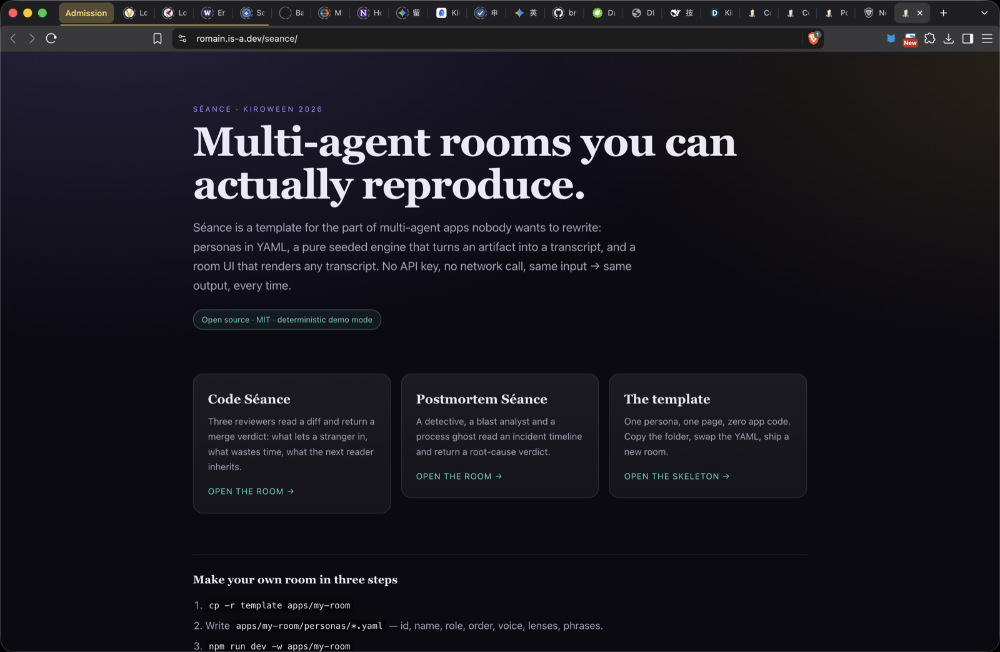
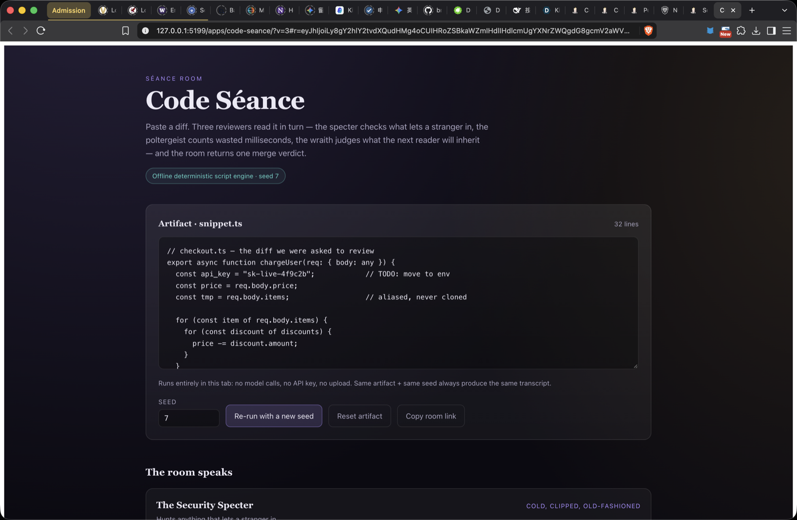
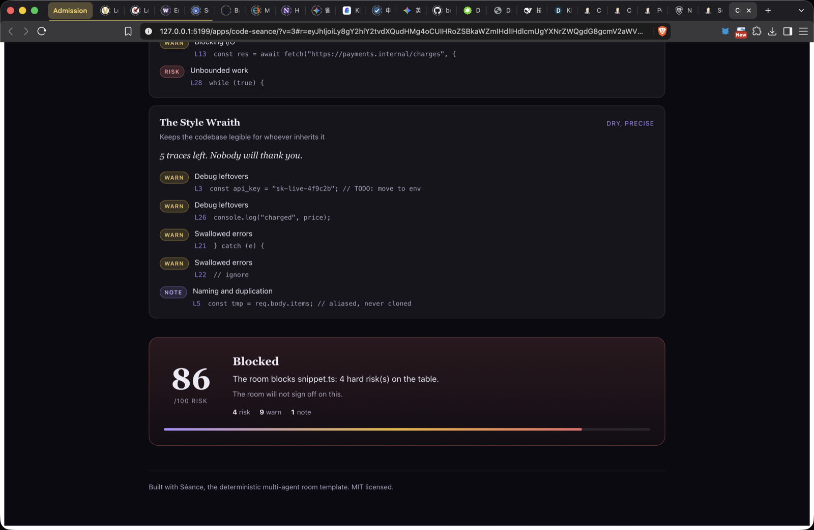

# Séance

**A skeleton template for deterministic multi-agent rooms — and two apps built from it.**

[](#tests)
[](https://romain.is-a.dev/seance/)
[](./LICENSE)

Séance is an open-source foundation for the part of multi-agent products nobody wants to
rebuild: **personas as data**, a **pure seeded engine** that turns an artifact into a transcript,
and a **reusable room UI**. Because the engine is pure, the same artifact and seed always produce
the same transcript — which makes multi-agent flows testable in CI and demoable without an
API key.

**Live demo:** <https://romain.is-a.dev/seance/> — no login, no key, no network calls.

- **Code Séance** — three reviewers read a diff and return a merge verdict.
- **Postmortem Séance** — a detective, a blast analyst and a process ghost read an incident
  timeline and return a root-cause verdict.

Both apps are produced from `template/` without touching the engine. That is the Skeleton Crew
claim: lean enough to read in one sitting, flexible enough to carry two different products.







## Why this exists

Multi-agent apps all rebuild the same three things, and they tangle them together:

1. **Who the agents are** — usually buried in prompt strings inside components.
2. **How a run unfolds** — usually inside a React effect, next to network calls.
3. **How a run is presented** — usually bespoke per product.

That tangle has a cost: you cannot test a conversation, you cannot replay a demo, and you cannot
change a persona without editing TypeScript. Séance splits the three:

| Concern | Lives in | Never touches |
|---|---|---|
| Personas | `apps/<app>/personas/*.yaml` | the engine |
| Run mechanics + scoring | `packages/seance-core` (pure) | React |
| Presentation | `packages/seance-ui` | persona content |

The payoff is a demo anyone can reproduce: **no key, no network, no tokens, same output**.

## Quickstart

```bash
npm install
npm test          # 45 unit + property tests
npm run build     # builds both apps and the landing page into dist/
npm run dev:code  # http://localhost:5173 — Code Séance
```

Open `dist/index.html` after a build to see the landing page, or run a local server:

```bash
python3 -m http.server 5199 --directory dist
```

## Share a room

The address bar always carries the room: `#r=<base64url>` encodes the artifact and the seed.
**Copy room link** puts a link on the clipboard, and opening it restores the exact same transcript
on someone else's machine — no server, no account, no storage. Oversized artifacts are truncated
to 4,000 characters rather than producing an unusable URL, and a malformed fragment falls back to
the app's defaults instead of crashing.

## Make your own room

1. Scaffold from the template:

   ```bash
   npm run new-room -- my-room
   # or, without npm: cp -r template apps/my-room
   ```

2. Write personas in `apps/my-room/personas/*.yaml`:

   ```yaml
   id: archivist
   name: The Archivist
   role: Checks that everything important is written down
   order: 1
   voice: patient, exacting
   lenses:
     - id: missing-context
       label: Missing context
       severity: warn
       keywords: [TODO, TBD, unclear, assumed]
   phrases:
     none: Everything is written down. I have no note to add.
     some: '{hits} gap(s) in the record.'
     many: '{hits} gaps. Nobody could inherit this.'
   ```

   `phrases` entries may contain several variants separated by `|`; the seed chooses one, which
   is why the same room can be re-voiced without changing its findings.

3. Point the app at your personas and run it:

   ```bash
   npm run dev -w apps/my-room
   ```

If a new room needs an edit to `packages/seance-core`, the template has a bug — fix the template,
not the app. `apps/*/personas` are validated against the schema by the test suite, so a broken
persona fails CI rather than the browser.

## Deploying

```bash
npm run deploy     # build + publish dist/ to the gh-pages branch
```

The Pages site is served from `gh-pages`; `.github/workflows` is intentionally empty because the
first push token lacked the `workflow` scope — the ready-made pipeline lives in
[`ci/deploy-pages.workflow.yml`](ci/deploy-pages.workflow.yml) with a two-line enable procedure.

## Architecture

```
packages/seance-core   persona schema · seeded RNG · turn loop · verdict scoring   (no DOM, no React)
packages/seance-ui     Room · AgentCard · VerdictCard · styles                      (no persona content)
template/              one persona, one page, zero app code — the copyable skeleton
apps/code-seance/      reference app #1: code review room
apps/postmortem-seance/reference app #2: incident postmortem room
.kiro/                 steering, specs, hooks (required by the hackathon rules)
docs/                  Kiro usage writeup, video script, blog and social drafts
```

### The engine contract

`runRoom({ artifact, personas, seed, scoring })` returns a `Transcript`. It is a pure function:

- no `Math.random()`, no `Date.now()`, no I/O — randomness comes from `jitter(seed, ...labels)`;
- personas are ordered by an explicit `order`, ties broken by `id`, so ordering never depends on
  file-system order;
- the input array is never mutated.

`scoreFindings` maps finding severities to an integer risk score in `[0, 100]`, and `decide` maps
that score to `ship | revise | block` with fixed thresholds (30 / 70).

## Tests

45 tests, including ten property-based invariants run through `fast-check`:

| Property | Statement |
|---|---|
| P1 | `runRoom` is deterministic — equal inputs produce deeply equal transcripts |
| P2 | the score is always an integer in `[0, 100]` |
| P3 | adding a `risk` finding never lowers the score |
| P4 | every score maps to exactly one decision at the 29/30 and 69/70 boundaries |
| P5 | one turn per persona, for any persona set of size 1..8 |
| P6 | the engine never mutates the persona array it was given |
| P7 | persona order is identical for any permutation of the input |
| P8 | `decodeRoomState(encodeRoomState(x)) === x` |
| P9 | the round-trip survives arbitrary unicode |
| P10 | a hostile fragment returns `null` instead of throwing |

Property-based testing earned its place here: P3 caught an early version of the scoring that
divided by a capacity derived from the finding count, so adding a finding could *lower* the
score. Unit tests used a fixed fixture and passed anyway.

## Kiro usage

The build was done inside Kiro with a spec-first workflow. The full writeup — which Kiro
surfaces were used, what the hooks automated, how steering shaped the output, and where the
spec beat vibe coding — is in [`docs/KIRO_USAGE.md`](./docs/KIRO_USAGE.md). The machine-readable
artifacts are in [`.kiro/`](./.kiro):

- `.kiro/steering/{product,tech,structure}.md` — always-on project memory
- `.kiro/specs/agent-room/{requirements,design,tasks}.md` — EARS requirements, design, task list
- `.kiro/hooks/{test-on-save,typecheck-on-save}.json` — agent hooks

## License

MIT — see [LICENSE](./LICENSE).

Built for the [Kiroween 2026](https://kiroween.devpost.com/) hackathon, **Skeleton Crew** category.

Deployed site: <https://romain.is-a.dev/seance/> · Source: <https://github.com/RomainCHEN/seance>
